# Awesome-Interactive-API-Documentation-Platform 🚀

  

  
  
  
  
  

---

# 🌟 Top Interactive API Documentation Platform Ecosystem

> **A Curated List of SaaS Developer Portals & Open-Source GitHub Projects**  
> *Targeted for OpenAPI/Swagger 3.1, AsyncAPI, GraphQL, gRPC, Interactive Sandboxes, SDK Generation & Docs-as-Code*  
> **Last updated: November 2026**

This repository tracks the leading **SaaS platforms** and **open-source projects** for **Interactive API Documentation Platforms**. These tools transform OpenAPI, AsyncAPI, GraphQL, and gRPC specifications into interactive developer portals featuring live "Try It Out" API consoles, multi-language code snippets, automated SDK generation, and versioned markdown guides.

---

## 📑 Table of Contents
- [📊 Sector Overview & Market Dynamics](#-sector-overview--market-dynamics)
- [☁️ SaaS / Hosted Platforms](#️-saas--hosted-platforms)
- [💻 Open-Source GitHub Projects](#-open-source-github-projects)
- [🤝 How to Contribute](#-how-to-contribute)
- [💖 Support](#-support)
- [📈 Star History](#-star-history)
- [⚠️ Disclaimer](#️-disclaimer)

---

## 📊 Sector Overview & Market Dynamics

The global API documentation and developer portal ecosystem forms a vital pillar of the broader **API Management Market**, currently valued between **$8.7 billion and $10.5 billion** and projected to surpass **$30 billion by 2032** at an impressive Compound Annual Growth Rate (**CAGR**) of **17%–21%**.

The sector exhibits **moderate-to-high fragmentation**: while full-lifecycle API management suites (like Google Apigee, AWS API Gateway, and MuleSoft) handle runtime traffic, the interactive documentation layer itself remains fiercely contested between developer-first docs-as-code startups (such as Mintlify, Fern, and Scalar), API lifecycle suites (like Postman and SmartBear/SwaggerHub), and community-driven open-source renderers (Swagger UI, Redoc, and Docusaurus). Due to universal open standards (OpenAPI, Markdown/MDX, AsyncAPI), switching costs remain low, preventing a singular "winner-take-all" outcome and driving continuous innovation in automated SDK generation and AI assistant integration.

---

## ☁️ SaaS / Hosted Platforms

Below is a detailed breakdown of top commercial SaaS and hosted interactive API documentation platforms, ranked in descending order by estimated company valuation/market scale.

| Product | Scale / Valuation / Revenue | Description | Pricing (Starting Tier) | Free Tier / Trial Limits |
| :--- | :--- | :--- | :--- | :--- |
| **[Postman API Documentation](https://postman.com)** | **$5.6B Valuation** (~$170M+ ARR) | Automated, machine-readable API documentation synced directly with Postman Collections, environments, and live request examples. | Solo starts at $9/user/month (billed annually); Team tier starts at $19/user/month (billed annually). | **Free forever plan:** Strictly 1 user (single-player only; no team collaboration/shared workspaces), unlimited collection runs, unlimited mock servers, and 50 AI credits/month. |
| **[SwaggerHub (SmartBear)](https://swagger.io)** | **~$1.8B–$1.9B Valuation** (SmartBear parent, ~$150M+ revenue) | Collaborative API design and documentation platform built around OpenAPI/AsyncAPI specifications with governance and mocking. | Individual plan starts at $19/user/month (billed annually) or $23/user/month (billed monthly). | **Free plan (Personal):** 1 user, 1 public product portal with branding, up to 5 domains, 10 contract tests, 10 AI credits, and 50 functional test runs. Paid plans offer a 14-day free trial. |
| **[Stoplight](https://stoplight.io)** | **Acquired by SmartBear** ($1.8B PE backed) | Design-first API platform combining visual OpenAPI modeling, automated style guides, mock servers, and hosted interactive docs. | Starter/Basic plan starts at $39/month. | **Free forever plan:** 1 user seat, up to 2 active projects, visual Studio editor, mock servers, and hosted interactive docs. Higher tiers offer a 14-day free trial. |
| **[Mintlify](https://mintlify.com)** | **$18M Series A** (a16z backed, hyper-growth scale-up) | Modern, AI-native documentation platform built for developer-first companies with native OpenAPI playgrounds and MDX support. | Pro starts at $450/month (billed annually) or $540/month (billed monthly). | **Free forever plan:** Up to 5 editor seats, 1 hosted docs site with custom domain, Git sync, web editor, and hosted MCP server (no native AI credits/assistant). |
| **[Fern](https://buildwithfern.com)** | **$13M Raised** ($9M Series A, Bessemer & YC backed) | Developer experience platform generating idiomatic multi-language SDKs and Stripe-like interactive API docs from OpenAPI definitions. | Custom enterprise pricing for advanced security, SSO, and full multi-language SDK automation. | **Free forever plan:** Up to 10 team members, 1 documentation site, up to 1,000 pages, 250 AI credits/month, 2,000 page generations/month, and basic TypeScript/Python SDK generation (up to 200 endpoints). |
| **[ReadMe](https://readme.com)** | **$10.3M Raised** (~$8M–$11M ARR, Accel & YC backed) | Interactive developer hub offering personalized API documentation, live request explorers, real-time API metrics, and changelogs. | Pro starts at $250/month (billed annually) or $3,000/month for Enterprise. | **Free forever plan (Starter):** 1 project, 1 admin seat, 1 published version, 7-day metric retention, custom domain, and base AI features. |
| **[GitBook](https://gitbook.com)** | **~$3.5M–$10M ARR** (Profitable bootstrapped scale-up) | Knowledge management and technical documentation platform supporting OpenAPI specification blocks, interactive endpoints, and Git sync. | Essential plan starts at $65/site/month + $12/user/month (billed annually) or $79/site/month + $15/user/month (billed monthly). | **Free forever plan:** Strictly 1 user, public docs hosted on `*.gitbook.io` subdomain (no custom domain), Git sync, interactive OpenAPI blocks, and MCP server support (no reader AI assistant). |
| **[Bump.sh](https://bump.sh)** | **€4M Raised (~$4.3M USD)** (Galion.exe & Bpifrance backed) | Automated API documentation and change management platform supporting OpenAPI/AsyncAPI with automated diffing and change alerts. | Basic plan starts at $50/month (10 API docs, 3 internal users, 20 guests); Pro starts at $120/month. | **No free forever plan.** Offers a **14-day free trial** of the Pro plan (no credit card required) with up to 30 API docs, 5 users, and full API explorer capabilities. Free for qualifying open-source projects. |
| **[Scalar (Cloud)](https://scalar.com)** | **Venture-Backed & Open-Source** (High-velocity adoption) | Modern API platform providing interactive OpenAPI references, built-in REST API testing clients, and hosted developer portals. | Pro starts at $125/month (billed annually) or $150/month (billed monthly). | **Free forever plan:** 1 editor seat, up to 3 APIs, 1 SDK (up to 25 endpoints), and 50 Agent Scalar AI credits. Core API reference renderer is open-source (MIT). |
| **[Redocly](https://redocly.com)** | **Bootstrapped & Profitable** (Marbruck Investments backed) | Enterprise API documentation and developer portal platform featuring customizable OpenAPI reference docs, linting, and RBAC. | Pro plan starts at $249/month (billed annually at $2,988/year) with unlimited seats. | **No free forever hosted plan.** Offers a **30-day free trial** with full platform access (3 projects, unlimited seats/pages, custom domains). Core CLI & Redoc engine are open-source. |

---

## 💻 Open-Source GitHub Projects

Curated list of open-source frameworks, specification parsers, static site documentation generators, and embedded API playgrounds — sorted in descending order by GitHub_Stars ⭐.

- **[Hoppscotch](https://github.com/hoppscotch/hoppscotch)**  ⚡  
  Open-source API development ecosystem, testing suite, and real-time interactive documentation explorer serving as an offline-first, lightweight alternative to Postman.

- **[Docusaurus](https://github.com/facebook/docusaurus)**  🦖  
  Popular open-source static site generator by Meta widely extended with OpenAPI plugins (`docusaurus-plugin-openapi-docs`) for building responsive interactive developer portals.

- **[Bruno](https://github.com/usebruno/bruno)**  🐶  
  Fast, Git-friendly open-source API client and documentation explorer that stores collections directly in your repo as plain-text files.

- **[Insomnia](https://github.com/Kong/insomnia)**  🌙  
  Leading open-source API design, debugging, and mock client platform with native OpenAPI specification preview and developer document generation.

- **[Backstage API Docs (by Spotify)](https://github.com/spotify/backstage)**  🎧  
  Open-source developer portal platform created by Spotify for centralizing OpenAPI, AsyncAPI, and gRPC specifications across microservice catalogs.

- **[Swagger UI](https://github.com/swagger-api/swagger-ui)**  📜  
  Industry-standard open-source renderer that dynamically parses OpenAPI/Swagger specifications into interactive HTML/JS consoles with live "Try It Out" execution.

- **[MkDocs Material](https://github.com/squidfunk/mkdocs-material)**  📚  
  Feature-rich open-source Python documentation framework supporting OpenAPI and Swagger plugins (`mkdocs-render-swagger-plugin`) for technical and API docs.

- **[OpenAPI Generator](https://github.com/OpenAPITools/openapi-generator)**  ⚙️  
  Community-driven open-source engine generating API client SDKs in 50+ programming languages, server stubs, and static HTML/Markdown documentation from OpenAPI specs.

- **[Redoc](https://github.com/Redocly/redoc)**  📑  
  Open-source, three-panel OpenAPI/Swagger-generated reference documentation engine recognized for clean typography, deep nesting support, and zero-dependency deployment.

- **[VitePress](https://github.com/vuejs/vitepress)**  ⚡  
  Vue-powered open-source static site generator frequently paired with `vitepress-openapi` for lightning-fast interactive API documentation sites.

- **[GraphiQL](https://github.com/graphql/graphiql)**  🔮  
  Official open-source in-browser IDE and interactive documentation explorer for GraphQL APIs featuring full schema introspection, history, and autocomplete.

- **[Scalar](https://github.com/scalar/scalar)**  🌐  
  Modern, open-source interactive API documentation renderer and offline-first API client built for OpenAPI 3.0/3.1 and Swagger 2.0 specifications.

- **[Nextra](https://github.com/shuding/nextra)**  ⚛️  
  Next.js and MDX-based open-source documentation framework ideal for building custom developer portals with embedded interactive API sandboxes and code playgrounds.

- **[Fumadocs](https://github.com/fuma-nama/fumadocs)**  📖  
  Modern open-source Next.js documentation framework featuring built-in OpenAPI playground generation, TypeScript twoslash, and full-text search.

- **[Starlight (by Astro)](https://github.com/withastro/starlight)**  ⭐  
  High-performance open-source documentation theme built on Astro, supporting `starlight-openapi` for blazing-fast interactive API reference pages.

- **[Swagger Editor](https://github.com/swagger-api/swagger-editor)**  ✏️  
  Browser-based open-source editor where you can write, edit, and visually preview OpenAPI descriptions with live real-time validation.

- **[GraphQL Voyager](https://github.com/APIs-guru/graphql-voyager)**  🛰️  
  Open-source interactive visual graph representation tool that renders any GraphQL API schema as an interactive, navigable node diagram.

- **[Swagger Core](https://github.com/swagger-api/swagger-core)**  ☕  
  The Java and JVM implementation of the OpenAPI Specification providing runtime annotations to generate live OpenAPI specifications.

- **[gRPC UI](https://github.com/fullstorydev/grpcui)**  📡  
  Interactive web UI for gRPC services that acts like Postman or Swagger UI by dynamically inspecting server reflection schemas.

- **[Prism (by Stoplight)](https://github.com/stoplightio/prism)**  🎭  
  Open-source HTTP mock and contract validation proxy server that powers realistic interactive examples directly from OpenAPI specifications.

- **[Fern Open-Source CLI](https://github.com/fern-api/fern)**  🌿  
  Open-source toolkit for defining APIs, validating OpenAPI specs, and generating idiomatic client SDKs and documentation artifacts.

- **[Kin-OpenAPI](https://github.com/getkin/kin-openapi)**  🐹  
  Popular Go package for loading, parsing, validating, and generating OpenAPI 3.0 and 3.1 specifications.

- **[Spectral (by Stoplight)](https://github.com/stoplightio/spectral)**  🔍  
  Flexible open-source JSON/YAML linter with out-of-the-box style rulesets for validating OpenAPI and AsyncAPI specifications prior to doc publication.

- **[Elements (by Stoplight)](https://github.com/stoplightio/elements)**  🧩  
  Embeddable open-source web components and React library for rendering interactive OpenAPI documentation, code samples, and "Try It" consoles.

- **[RapiDoc](https://github.com/rapi-doc/RapiDoc)**  🚀  
  Lightweight, customizable open-source web component for viewing OpenAPI 3.0/3.1 specifications with built-in request execution and customizable themes.

- **[oasdiff](https://github.com/Tufin/oasdiff)**  🔍  
  Open-source Go-based diffing tool for OpenAPI specifications to detect breaking changes and automatically generate interactive changelogs.

- **[SpectaQL](https://github.com/anvilco/spectaql)**  💡  
  Open-source static documentation generator specifically engineered to produce clean, single-page interactive GraphQL API documentation.

- **[Docusaurus OpenAPI Docs](https://github.com/PaloAltoNetworks/docusaurus-openapi-docs)**  🦖  
  Open-source Docusaurus plugin that generates rich, interactive OpenAPI documentation with live code playground execution.

- **[AsyncAPI Generator](https://github.com/asyncapi/generator)**  🔄  
  Open-source CLI and templating engine to generate interactive documentation, markdown pages, and client code from AsyncAPI specifications.

- **[AsyncAPI Studio](https://github.com/asyncapi/studio)**  📻  
  Open-source interactive playground and browser studio for designing, testing, and documenting event-driven APIs (Kafka, MQTT, WebSockets, AMQP).

---

## 🤝 How to Contribute

Contributions make the open-source community thrive! To add or update an entry:

1. 🍴 **Fork the repo.**
2. ✍️ **Add or edit entries in `README.md`** (follow existing tabular and list formats).
3. 📝 **Include details**: Tool name, link, 1–2 sentence description, pricing/scale for SaaS, or Stars_Badges for open-source repositories.
4. 🚀 **Submit a Pull Request (PR)** with a concise summary of changes.

Don't forget to ⭐ star the repository if you find it helpful!

---

## 💖 Support

If this repository helped you discover the best interactive documentation platform or saved your team time:

- ⭐ **Star this repository** to help others find it.
- 🍴 **Fork and share** with colleagues, developer advocates, and API platform architects.
- ☕ **Sponsor & Buy a Coffee:** Support ongoing maintenance via the [GitHub Sponsor Dashboard](https://github.com/sponsors/ishandutta2007).

Thank you for being part of the open-source and API developer experience community! 🙏

---

## 📈 Star History

---

## ⚠️ Disclaimer

- This is an independent, community-curated collection intended for educational and reference purposes. It does not constitute a formal commercial endorsement.
- Interactive API documentation portals exposing live "Try It Out" consoles must enforce strict CORS policies, rate limiting, and sandbox API key credential isolation.
- Self-hosted open-source documentation portals should keep OpenAPI specifications versioned, linted, and validated within CI/CD pipelines.

---

  <b>Built with ❤️ for API engineers, developer advocates, technical writers, and platform architects worldwide.</b> 
  <i>Let's make API documentation more interactive, accurate, and open.</i>

